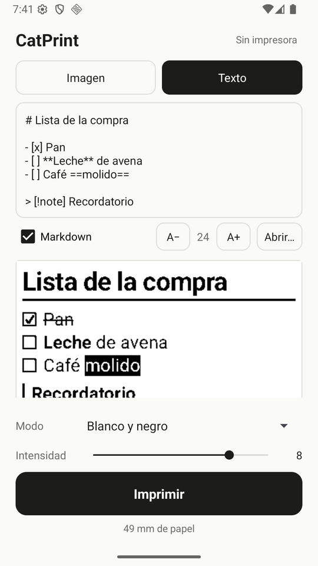
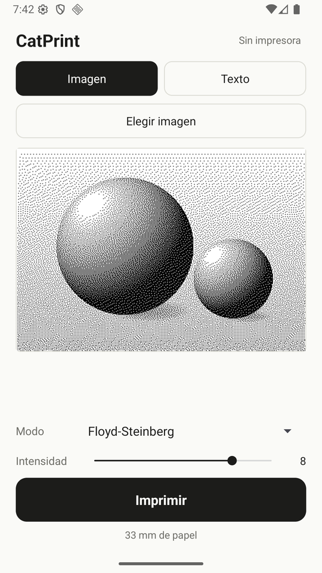

# CatPrint

App Android mínima para imprimir en las impresoras térmicas "cat printer" por Bluetooth LE.
Sin publicidad, sin cuentas, sin internet y sin librerías externas: el APK pesa menos de 100 KB.

Es un port a Kotlin de [catprinter](https://github.com/rbaron/catprinter) de rbaron (Python),
con el soporte para MXW01 del fork de [guillorrr](https://github.com/guillorrr/catprinter).

<p align="center">
  
  
</p>

## Qué hace

- **Imágenes**: desde la galería o con *Compartir → CatPrint* desde cualquier app.
- **Texto**: escribe o pega texto, o ábrelo desde un `.txt`.
- **Markdown** (estilo Obsidian): títulos, **negrita**, *cursiva*, ~~tachado~~, `código`,
  ==resaltado==, listas, tareas, citas y callouts (`> [!note]`), bloques de código, tablas,
  líneas, `[[wikilinks]]`, front matter y `%% comentarios %%`, más ecuaciones `$...$` y `$$...$$`
  (el LaTeX común se convierte a símbolos Unicode con superíndices y subíndices; no es
  tipografía LaTeX completa).
- **Modos**: 16 niveles de gris reales (solo MXW01), Floyd-Steinberg, Atkinson, semitono y
  blanco y negro.
- **Intensidad** de 1 a 10.
- La vista previa muestra exactamente lo que va a salir y cuánto papel usa.

## Impresoras

| Modelo | Protocolo |
|---|---|
| GB01, GB02, GB03, GT01 | `0x51 0x78` en `0xae01` |
| MXW01 | `0x22 0x21` en `0xae01`, imagen en `0xae03` |

El modelo se detecta por el nombre que anuncia la impresora. La primera vez la app la busca y
guarda su dirección, y desde entonces siempre usa esa aunque haya otras encendidas.

Si hay varias en la sala, te pregunta cuál usar, la más cercana primero, con el final de su
dirección para distinguir dos del mismo modelo (para saber cuál es cuál, acerca el teléfono a la
que quieres). Para cambiar de impresora, toca su nombre arriba a la derecha.

## Compilar

Requiere JDK 17+ y el Android SDK (platform 36).

```bash
echo "sdk.dir=$HOME/Android/Sdk" > local.properties
./gradlew testDebugUnitTest assembleRelease
# APK: app/build/outputs/apk/release/app-release.apk
```

El build *release* se firma con la clave de debug: sirve para instalarlo en tu propio
teléfono (`adb install app-release.apk` o copiando el APK), no para publicarlo en Play Store.

## Estructura

| Archivo | Qué hace |
|---|---|
| `Protocol.kt` | Bytes de ambos protocolos (checksum, RLE, comandos). Probado contra la versión Python. |
| `Printer.kt` | BLE: búsqueda, conexión, MTU, envío por partes y espera de confirmaciones. |
| `Raster.kt` | Carga de imagen, escalado a 384 puntos y dithering. |
| `TextRender.kt` | Texto plano y Markdown dibujados directamente en puntos de impresora. |
| `MainActivity.kt` | La única pantalla. |

## Licencia

[MIT](LICENSE). Incluye código portado de catprinter, © 2021 rbaron, también bajo MIT.
